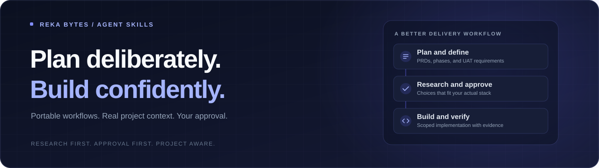

<div align="center">
  <h1>Reka Bytes Agent Skills</h1>
  <p>Better plans. Stack-aware engineering. Your approval, every step.</p>
  <p>Portable workflows for agents that support the Agent Skills format.</p>
</div>

<p align="center">
  <a href="https://skills.sh/rekabytes-enterprise/agentskills"></a>
  <a href="https://github.com/Rekabytes-Enterprise/agentSKills/stargazers"></a>
  <a href="https://github.com/Rekabytes-Enterprise/agentSKills/actions/workflows/validate.yml"></a>
  <a href="https://agentskills.io"></a>
  <a href="LICENSE"></a>
</p>

<p align="center">
  <a href="#quick-start">Quick start</a> ·
  <a href="#skill-catalog">Skills</a> ·
  <a href="#how-it-works">Workflow</a> ·
  <a href="#installs-and-downloads">Activity</a> ·
  <a href="CONTRIBUTING.md">Contribute</a> ·
  <a href="https://github.com/Rekabytes-Enterprise/agentSKills/archive/refs/heads/main.zip">Download ZIP</a>
</p>

---

## Why this library

Give your agent a repeatable process—not another fixed-stack template.

| Plan before building | Match the real project | Keep decisions yours |
| --- | --- | --- |
| Detailed PRDs, bounded phases, and UAT plans | Research compatible tools against the PRD and actual code | Approval before planning documents, configuration, and separately authorized implementation |

These skills are Markdown instructions, reference guides, and templates. No application, npm package, or MCP server needs to be published by this library.

## Quick start

Run this inside your project:

```bash
npx skills add Rekabytes-Enterprise/agentSKills
```

Select **all skills or individual skills**, then choose your supported agent in the interactive installer. Agent selection and installation paths are handled by the [Skills CLI](https://github.com/vercel-labs/skills), which supports agents such as Claude Code, Codex, Cursor, and OpenCode.

For a global installation, add `-g`. Engineer still keeps each project's approved configuration in that project's directory—not in a shared global skill.

> [!IMPORTANT]
> GitHub installation requires the skill files to be pushed and the repository to be accessible. Private repositories require authenticated access. Publishing the library needs only GitHub; users choosing `npx` need Node.js/npm.

<details>
<summary><strong>Prefer Git or ZIP? Install without npm</strong></summary>

Clone or [download the repository](https://github.com/Rekabytes-Enterprise/agentSKills/archive/refs/heads/main.zip), then copy the entire selected `skills/<skill-name>/` folder into your agent's supported skills directory. Keep `SKILL.md`, `references/`, and `templates/` together.

For example, from a target project's root, Claude Code users can copy engineer from a downloaded checkout:

```bash
mkdir -p .claude/skills
cp -R /path/to/agentSKills/skills/engineer .claude/skills/
```

Check for an existing skill folder first; review updates instead of overwriting local customizations. Other agents may use different directories—consult their documentation.

</details>

## Skill catalog

| Skill | Best for | What it produces | Directory activity |
| --- | --- | --- | --- |
| [**project-manager**](skills/project-manager/SKILL.md) | Turning an idea or draft into an approved delivery plan | Master PRD, phase PRDs, per-phase UAT tester requirements, and evidence-backed progress checklists | [View on skills.sh](https://skills.sh/rekabytes-enterprise/agentskills/project-manager) |
| [**engineer**](skills/engineer/SKILL.md) | Researching, configuring, implementing, or reviewing the actual project stack | Approved project-local engineering profile and scoped, separately authorized implementation | [View on skills.sh](https://skills.sh/rekabytes-enterprise/agentskills/engineer) |

<details>
<summary><strong>project-manager — from draft to testable phases</strong></summary>

Ask your agent:

> Use project-manager to plan this project from my draft. Compare suitable stacks, managed versus self-hosted hosting, and authentication options. Discuss the tradeoffs and ask for my approval before creating the PRDs.

It discusses users, scope, constraints, stack/hosting/auth choices, and the phase outline first. After proposal approval, it generates extensive documents inside **your project**:

```text
docs/development/
├── README.md                  # Document index and phase tracker
├── PRD.md                     # Master product requirements
└── phases/
    ├── 01-<phase-name>/
    │   ├── PRD.md             # Requirements, tasks, acceptance criteria
    │   └── UAT.md             # Testers, setup, scenarios, results, sign-off
    └── 02-<phase-name>/
        ├── PRD.md
        └── UAT.md
```

Phase count and names follow the project. Every phase gets tester requirements, executable UAT cases, expected results, evidence fields, defect handling, and sign-off criteria. Documentation approval, verified implementation, UAT execution, and user acceptance are separate milestones.

Generated PRDs/UAT plans still require your review. No automatic development or deployment follows document approval.

</details>

<details>
<summary><strong>engineer — compatible choices, not a forced stack</strong></summary>

Ask your agent:

> Use engineer for this project. First review our PRD, phase plans, and existing code. Research compatible state management and other engineering tools, compare options, and ask me to approve the configuration before saving it or starting development.

Engineer inspects actual runtimes, manifests/lockfiles, rendering, data/state ownership, errors, auth boundaries, design/motion, testing, and operations. It researches version-compatible choices and stops for configuration approval before saving:

```text
docs/development/engineer-profile.md
```

| Actual stack | Research direction—not an automatic dependency choice |
| --- | --- |
| Next.js / React | Local state first; retain or recommend Jotai only when suitable |
| Vite / Vue | Vue primitives and potentially Pinia; Vite is a build tool, not a state library |
| Laravel / Blade or Livewire | Native server/component/browser boundaries; no mandatory JavaScript store |
| Laravel / Inertia | Consider Laravel and the actual React/Vue client separately |
| Plain PHP | Request/session/database state; browser state only where needed |

Later uses reload the profile and check it against current project evidence. Material drift requires targeted research and approval. Updating the profile specializes engineer for **this project only**; it does not rewrite the shared skill or automatically upgrade dependencies.

Mokara-derived engineering, architecture, and separate client/admin design workflows are retained. Their visual presets are options for new UIs; existing approved design remains the benchmark. No Mokara application source, fonts, or assets are bundled. Client, admin, and marketing identities stay separate.

</details>

## How it works

| Step | Who acts | Outcome |
| --- | --- | --- |
| 1 | Project Manager | Discuss the draft, compare choices, propose scope and phases |
| 2 | You | Approve the planning proposal |
| 3 | Project Manager | Write master/phase PRDs and UAT plans; request document review |
| 4 | You | Approve the specific PRD/UAT revisions and phases |
| 5 | Engineer | Research compatible choices against the PRD and actual stack |
| 6 | You | Approve project-local engineer configuration |
| 7 | You + Engineer | Explicitly authorize a task, then implement and verify within that scope |
| 8 | Tester + acceptance owner | Execute UAT, record evidence/defects, and decide phase acceptance |

**A checkbox is evidence—not a promise.** Implementation checks do not imply UAT passed, and passing tests do not replace your sign-off. Installing a skill does not authorize code changes, infrastructure provisioning, commits, pushes, or deployment.

## Installs and downloads

The install badge uses the native [skills.sh badge endpoint](https://skills.sh/b/rekabytes-enterprise/agentskills) demonstrated in the [Skills CLI documentation](https://github.com/vercel-labs/skills). It reports the directory's installation activity for this library—not npm downloads of the `skills` installer.

| Signal | Where to view it | What it means |
| --- | --- | --- |
| Reported skill installs | [Library activity](https://skills.sh/rekabytes-enterprise/agentskills) and the individual skill pages above | Telemetry-based install activity; **not unique users** or a universal download total |
| GitHub stars | [Stargazers](https://github.com/Rekabytes-Enterprise/agentSKills/stargazers) | Repository interest, not installs |
| Repository views and clones | [GitHub Traffic](https://github.com/Rekabytes-Enterprise/agentSKills/graphs/traffic) | GitHub's traffic window; available to repository owners or users with the required permissions |
| ZIP / manual installation | [Download ZIP](https://github.com/Rekabytes-Enterprise/agentSKills/archive/refs/heads/main.zip) | Available without npm; this repository does not count these installations |

> [!NOTE]
> Live directory stats depend on publication, indexing, and reported usage. Badges may be unavailable before those exist. There is no reliable all-time total combining CLI installs, Git clones, ZIP downloads, and manual copies. Versioned release assets could expose separate GitHub download counts if releases are added later.

**Privacy:** this repository adds no custom install hooks or analytics scripts. The Skills CLI offers telemetry opt-out through `DISABLE_TELEMETRY` or `DO_NOT_TRACK`; opted-out usage is not included in telemetry-based metrics. See its documentation for current behavior.

## Keep skills current

For CLI-managed installations:

```bash
npx skills check
npx skills update
```

For manual installs, update your checkout and review/re-copy the skill folder. Library updates do not overwrite the consuming project's engineer profile; compatibility changes still require review.

## Contributing

Read the [contribution guide](CONTRIBUTING.md) for the `dev` branch workflow, skill conventions, validation, and pull request checklist.

Add a self-contained folder under `skills/<skill-name>/` with:
- `SKILL.md`: lowercase, hyphenated `name` matching the folder and a descriptive, single-line `description`.
- `references/` and `templates/` when useful, with relative links inside the skill package.
- Clear scope, approval boundaries, expected outputs, and verification guidance.

No credentials, private data, personal-machine paths, or one-project stack assumptions. See the [Agent Skills specification](https://agentskills.io) for the format.

Validate with Python 3.9+—no dependencies to install:

```bash
python3 -B scripts/validate_skills.py
python3 -B -m unittest discover -s tests -v
```

The [validation workflow](.github/workflows/validate.yml) checks metadata, local links, portability, and static contracts. Tests do not demonstrate live agent behavior or guarantee external counters. Python is a contributor tool, not a requirement for using these skills.

### Licensing

Licensed under the [MIT License](LICENSE). See the license for permissions, required notices, and warranty terms.

---

<p align="center">Built by Reka Bytes · Plan with context. Build with intent.</p>
